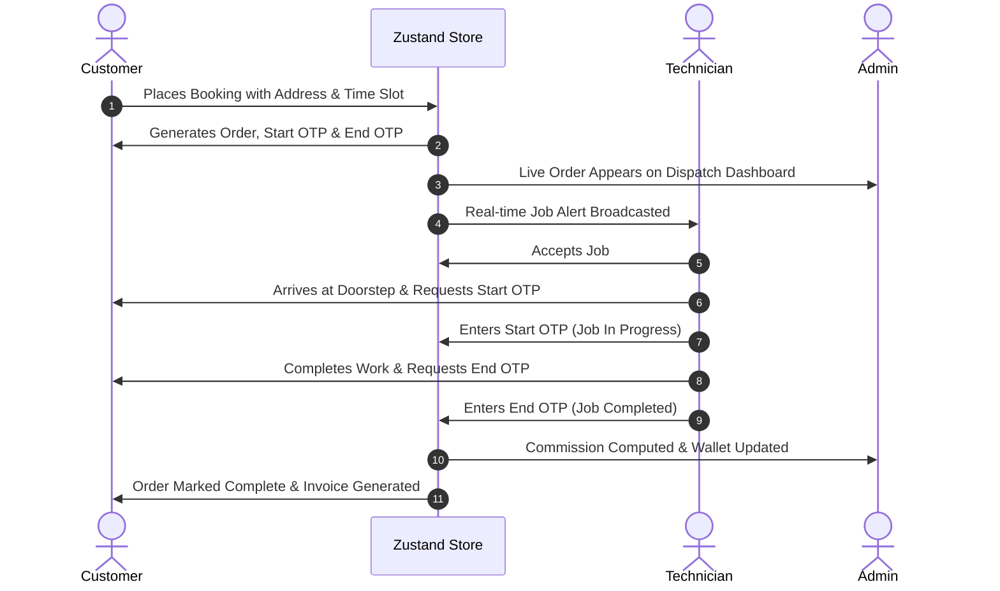

# 🛠️ Servicewala — Multi-Portal On-Demand Home Services Ecosystem

[](https://reactnative.dev/)
[](https://expo.dev/)
[](https://www.typescriptlang.org/)
[](https://zustand-demo.pmnd.rs/)
[](LICENSE)

An enterprise-grade, **Urban Company & HomeAdvisor inspired** Multi-Portal Home Services Platform built with **React Native (Expo + Expo Router + React Native Web + TypeScript)**. 

From a single unified codebase, **Servicewala** delivers:
1. **Desktop/Laptop Web Experience:** Ultra-fast, responsive web applications for Customers and Operations Admin.
2. **Mobile Apps:** Ready-to-compile cross-platform native mobile applications (iOS & Android) for Customers and On-Field Technicians.

---

## 🌟 Triple-Portal Architecture

Servicewala unifies three complete user roles into one synchronized ecosystem:

### 1. 🛒 Customer Portal (`app/(customer)`)
- **Urban Company Style Header:** City location selector (Kolkata, Salt Lake, Howrah, etc.), direct category links (*Home, Computer, Printer, Air Conditioner*), global search, cart counter, and Profile dropdown menu with active bookings badge.
- **HomeAdvisor Luxury Hero Section:** Clean framed workstation hero banner, frosted glass headline card, and responsive pill search capsule with smooth focus styling, live filtering, and auto-scroll to search results.
- **10-Category Specialized Quick Bar:** Direct filtering for *Laptop & Mac, Desktop PC, Printer Repair, AC Service, Refrigerator, Washing Machine, Geyser, Chimney, Air Cooler, Home Cleaning*.
- **Seasonal Deals & Offers:** One-tap promo code apply with instant checkout price deductions.
- **Verified Before & After Quality Showcase:** Interactive side-by-side craftsmanship comparisons with verified delta metrics (AC Deep Jet Wash, Laptop Thermal Overhaul, Kitchen Chimney Degreasing, Electrical DB Upgrade) and direct cart booking integration.
- **₹10,000 Home Protection Promise Shield:** Zero-liability property damage coverage, 48-hour digital claim settlement, and 100% UIDAI biometric & police-verified technicians.
- **22+ Multi-Brand Infinite Continuous Marquee:** Ultra-smooth CSS-driven infinite loop featuring OEM authorized repair badges for Samsung, Apple, LG, Voltas, HP, Dell, and other top global brands.
- **Mobile App Download & Live GPS Mockup:** Native-styled iPhone frame showcasing dynamic island, real-time technician arrival radar (14-min ETA), and Start OTP security handshake.
- **Interactive FAQ Accordion:** Comprehensive customer help covering technician verification, rapid dispatch (45-60 min arrival), transparent pricing, and 30-day warranty.
- **Floating Quick Help & Diagnostic Assistant:** Sticky flyout capsule offering 1-tap issue diagnostics, immediate cost estimates, direct WhatsApp consultation, and 2-minute callback requests.
- **Dedicated Product & Service Details Pages (`service/[id]`):** Rich presentation featuring high-res imagery, what's included/excluded checklists, 30-day guarantee badge, desktop sticky pricing card, and mobile fixed booking bar.
- **Interactive Cart & Checkout:** Schedule selection, dynamic cart total, address input, and cash/online payment.
- **Live Order Tracking:** Active booking status tracking with customer-side 4-digit **Start OTP** and **End OTP**.
- **Modular Component Architecture:** 100% clean ~140-line master orchestrator importing 16 self-contained modules from `src/components/home/`.

### 2. 🧰 Technician / Partner Portal (`app/(partner)`)
- **Job Feed & Radar:** Instant broadcast notifications for new booking requests matching the technician's skills.
- **Two-Factor Job Security:** 
  - Verification of **Start OTP** provided by customer before beginning work.
  - Verification of **End OTP** upon job completion.
- **Earnings & Commission Ledger:** Detailed gross revenue, platform commission deduction (15%), net payouts, and wallet balance.
- **Partner Profile & KYC:** Status toggle (*Online / Busy / Offline*), ratings, completed job counts, and verification badges.

### 3. 📊 Operations Admin Control Center (`app/(admin)`)
- **Live Analytics Dashboard:** Real-time Gross Merchandise Value (GMV), completed jobs, active technicians, and booking volume graphs.
- **Dispatch Management:** Live booking order monitoring with manual/automatic technician reassignment and cancellation overrides.
- **Dynamic Catalog Manager:** Complete CRUD for services, price edits, category reassignments, and duration adjustments.
- **Fleet Verification:** Review and approve/reject technician KYC documents and adjust commission rates.

---

## ⚡ The Live Simulation Engine (`useEcosystemStore.ts`)

Servicewala implements a **100% reactive client-side simulation engine** powered by **Zustand**:
- **No external backend required for Phase 1 demoing:** Every action in the Customer portal immediately updates the Technician and Admin portals in real-time.
- **Docked Portal Switcher Bar:** Easily toggle between **Customer**, **Technician**, and **Admin** views from the floating bar at the bottom of the screen.
- **Cross-Portal Toast Notifications:** When an order is booked or updated, real-time toast alerts appear across all views.

---

## 🔄 Booking Lifecycle Flow



---

## 🚀 Quick Start Guide

### Prerequisites
- [Node.js](https://nodejs.org/) (v18 or higher recommended)
- `npm` or `bun`

### 1. Clone the repository
```bash
git clone https://github.com/saiff99/servicewala.git
cd servicewala
```

### 2. Install dependencies
```bash
npm install
```

### 3. Start the application
```bash
# Start in Web mode (Default)
npm run web

# Start with Expo interactive menu (Scan QR code with Expo Go)
npm run start
```
Open **`http://localhost:8081`** in your browser.

---

## 📁 Repository Directory Structure

```
servicewala/
├── app/                         # Expo Router File-Based Routing
│   ├── (admin)/                 # Operations Admin Panel
│   ├── (customer)/              # Customer Marketplace & Checkout
│   │   └── index.tsx            # Clean 140-line master orchestrator
│   ├── (partner)/               # Technician Mobile-First Portal
│   ├── _layout.tsx              # Root Layout & Global Providers
│   └── index.tsx                # Entry Redirection
│
├── src/
│   ├── components/              # Shared Components (PortalSwitcherBar, NotificationBanner, BrandLogos)
│   │   └── home/                # 16 Isolated Customer Home Modules (Hero, Strip, Quality, FAQ, Footer, etc.)
│   ├── constants/               # Global Theme, Colors, Breakpoints & Typography
│   ├── data/                    # Rich Initial Mock Data (Categories, Services, Techs)
│   └── store/                   # Zustand Global Ecosystem Store (State & Actions)
│
├── AGENTS.md                    # AI Agent Guidelines & Context Engineering
├── ARCHITECTURE.md              # Technical Architecture & Data Flow Guide
├── package.json                 # Project Dependencies & Scripts
└── tsconfig.json                # TypeScript Strict Configuration
```

---

## 🛠️ Verification & Quality Checks

Run typechecks and linting before submitting pull requests:
```bash
# TypeScript Typecheck
npx tsc --noEmit

# ESLint Rule Verification
npx expo lint
```

---

## 📄 License
This project is licensed under the MIT License — see the [LICENSE](LICENSE) file for details.
